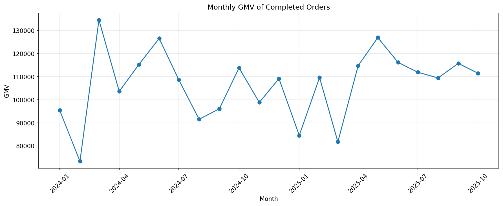
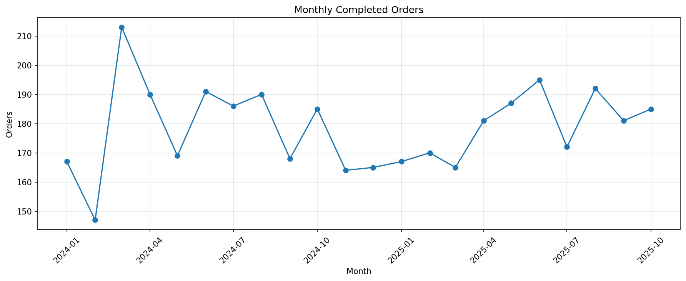
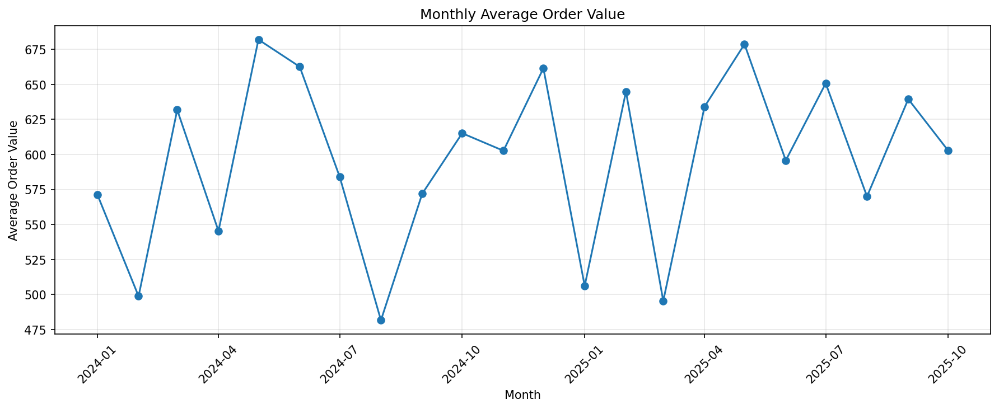
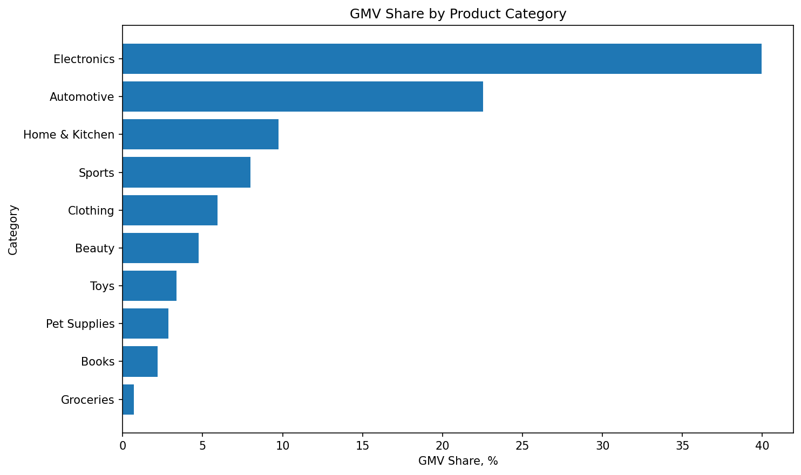

# E-commerce Product Analysis

Pet-project по продуктовой и data-аналитике на данных e-commerce продукта.

Цель проекта — исследовать покупательское поведение, динамику завершённых заказов, структуру продаж по товарам и категориям, а также проверить качество и логическую согласованность исходных данных.

## Цель анализа

В рамках проекта я хотела ответить на несколько вопросов:

- как меняются ключевые коммерческие показатели во времени
- какая доля покупателей совершает повторные покупки
- какие категории формируют основной GMV
- чем объясняется высокий вклад отдельных категорий
- насколько продажи концентрируются вокруг небольшого числа товаров
- связан ли рейтинг товара с его коммерческими результатами
- можно ли использовать события пользователей, даты регистрации и отзывы для дополнительного продуктового анализа

## Данные

В анализе использовались шесть таблиц:

- `events` — пользовательские события
- `orders` — заказы
- `order_items` — товарные позиции внутри заказов
- `products` — характеристики товаров
- `users` — пользователи
- `reviews` — отзывы

Данные охватывают период с января 2024 года по 14 ноября 2025 года.

Ноябрь 2025 года представлен не полностью, поэтому он исключён из сравнительного анализа полных календарных месяцев.

## Ключевые показатели

Для завершённых заказов:

- **4 021** завершённый заказ
- **3 320** уникальных покупателей
- **2 419 712.58** GMV
- **601.77** средняя стоимость заказа
- **612** повторных покупателей
- **18.43%** покупателей совершили более одной завершённой покупки
- медианный интервал между повторными покупками — около **171 дня**

## Динамика продаж

По полным месяцам 2024–2025 годов устойчивого долгосрочного роста или снижения GMV не наблюдается.

Изменения GMV связаны одновременно с:

- количеством завершённых заказов
- средней стоимостью заказа

Максимальный GMV среди полных месяцев наблюдался в марте 2024 года — около **134.6 тыс.** В этом же месяце было максимальное количество завершённых заказов — **213**.



Количество завершённых заказов по месяцам:



Динамика средней стоимости заказа:



## Анализ категорий

Категории заметно отличаются по денежному вкладу.

- **Electronics — 39.94% GMV**
- **Automotive — 22.52% GMV**

Вместе эти две категории формируют **62.46% общего GMV завершённых заказов**.

При этом высокий вклад в GMV не означает максимальное количество проданных единиц.

Например, категории `Beauty`, `Toys` и `Pet Supplies` имеют высокий объём продаж в штуках, но значительно меньший денежный вклад.



Основная причина различий — стоимость товаров.

Медианная цена проданной единицы:

- Electronics — около **788**
- Automotive — около **383**
- Toys — около **56**
- Pet Supplies — около **49**
- Groceries — около **16**

Таким образом, высокий GMV Electronics и Automotive объясняется прежде всего более высокой стоимостью товаров.

## Концентрация продаж

Все 10 лидирующих товаров по GMV относятся к категории Electronics.

При этом топ-10 товаров формируют только **14.54% GMV категории Electronics**.

Это означает, что высокий GMV категории не зависит от нескольких отдельных SKU и распределён между большим количеством товаров.

## Рейтинг и продажи

Корреляция рейтинга товара с количеством проданных единиц составляет **0.016**, а с GMV — **0.003**.

Выраженной линейной связи между рейтингом товара и его коммерческими результатами в данных не обнаружено.

Корреляция между количеством проданных единиц и GMV составляет **0.318** — связь положительная, но не сильная, поскольку GMV зависит не только от количества продаж, но и от стоимости товара.

## Проверка качества данных

В проекте отдельно проверялась не только техническая, но и логическая согласованность данных.

### Events

После сопоставления событий `cart` и `purchase` на уровне одного пользователя и товара не удалось восстановить корректную последовательность `cart → purchase`.

Поэтому количество событий не использовалось как полноценная пользовательская воронка.

### Users

Для **9 930 заказов** дата заказа предшествует `signup_date`.

Поэтому дата регистрации не использовалась для анализа:

- времени до первой покупки
- конверсии после регистрации
- пользовательских когорт

### Reviews

Для **7 455 отзывов**, или примерно **49.7%**, дата отзыва предшествует дате соответствующего заказа.

Поэтому `review_date` не использовалась для анализа поведения после покупки.

Эти ограничения были учтены при выборе метрик и формулировке продуктовых выводов.

## SQL-анализ

Для проекта дополнительно подготовлены SQL-запросы в диалекте PostgreSQL.

В анализе используются:

- `JOIN`
- `CTE`
- агрегатные функции
- условная агрегация
- `CASE`
- работа с датами
- `LAG`
- `ROW_NUMBER`
- `DENSE_RANK`
- оконные функции
- расчёт долей и ранжирование

SQL-анализ включает:

- помесячные коммерческие метрики
- GMV и долю GMV по категориям
- топ товаров внутри категорий
- концентрацию GMV Electronics
- частоту повторных покупок
- интервалы между заказами
- первую и вторую покупку
- сегментацию покупателей по количеству заказов

Файлы:

- `sql/product_analysis.sql`
- `sql/user_behavior.sql`

## A/B-test mini-case

Отдельный notebook посвящён анализу синтетического A/B-теста изменения checkout.

В кейсе рассмотрены:

- формулировка продуктовой гипотезы
- выбор primary, secondary и guardrail-метрик
- H0 и H1
- Conversion Rate
- ARPU
- абсолютный и относительный uplift
- z-test для сравнения долей
- Welch t-test для ARPU
- p-value
- 95% доверительные интервалы
- MDE
- statistical power
- ошибки I и II рода
- статистическая и продуктовая значимость результата

В эксперименте вариант B увеличил Conversion Rate с **11.61% до 13.39%**, при этом статистически значимого ухудшения Checkout Error Rate обнаружено не было.

На основании основной, дополнительной и guardrail-метрик вариант B был рекомендован к постепенному rollout.

Notebook:

- `notebooks/02_ab_test_case.ipynb`

## Стек

- Python
- pandas
- NumPy
- matplotlib
- SciPy
- statsmodels
- SQL
- PostgreSQL
- Jupyter Notebook

## Структура проекта

```text
ecommerce_product_analysis/
├── images/
│   ├── gmv_share_by_category.png
│   ├── monthly_aov.png
│   ├── monthly_completed_orders.png
│   └── monthly_gmv.png
│
├── notebooks/
│   ├── 01_data_overview.ipynb
│   └── 02_ab_test_case.ipynb
│
├── sql/
│   ├── product_analysis.sql
│   └── user_behavior.sql
│
├── .gitignore
└── README.md
```

Исходные CSV-файлы хранятся локально в `data/raw/` и не добавляются в репозиторий
